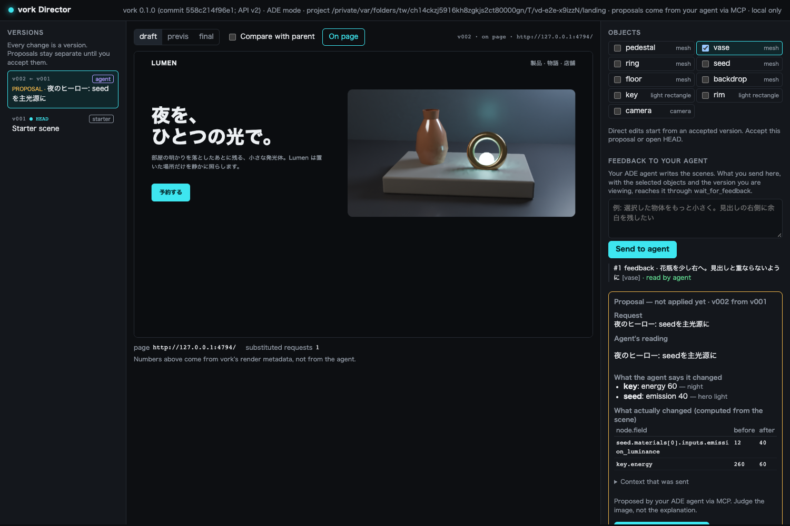

# agent-render-review

アプリ内の表示名は「vork Director」です。

[vork](https://github.com/voyager-so/vork)（エージェント向けのヘッドレス3D/VFXエンジン）で作ったビジュアルを、人間がレビューして採用するためのローカルWebアプリです。

モードは2つあります。

- **ADEモード**: Claude Code や Codex などのエージェントが、MCP経由でシーンを書き、描画を見て直します。人間は Director で候補を比較し、画像を指してフィードバックを返し、採否を決めます。採用した画像とシーンはプロジェクトに書き戻されます。
- **単独モード**: Director に内蔵したエージェント（`claude -p`、ツールなし）に日本語で指示します。



## 必要なもの

- vork 0.1.0（Apple Silicon + macOS 26以降、またはNVIDIA RTX + Vulkan）
- Node.js 22以降
- ページプレビューに Google Chrome（`CHROME_PATH` で変更可）
- 単独モードに Claude Code CLI（`claude`、ログイン済み）

```sh
npm install
```

## ADEモード

### 1. MCP を登録する

プロジェクトのルートで登録します。Director はエージェントが最初にツールを呼んだときに自動で起動し、状態を `<project>/.vork/` に保存します。

**Claude Code**

```sh
claude mcp add vork -- node /path/to/vork-director/mcp.mjs --project .
```

**Codex**（`~/.codex/config.toml`）

```toml
[mcp_servers.vork]
command = "node"
args = ["/path/to/vork-director/mcp.mjs", "--project", "/path/to/your/project"]
startup_timeout_sec = 30
tool_timeout_sec = 300
default_tools_approval_mode = "approve"   # 無いと承認ポリシーによってはツール呼び出しが拒否される
```

動作確認の範囲:

- Claude Code 2.1.319: 上のコマンドで登録すると `claude mcp list` が Connected を表示した。`--mcp-config` で一時登録した状態で、`get_render` の画像の内容をエージェントが説明できた。
- Codex CLI 0.167.0: `-c mcp_servers.vork.*` で上の設定と同じ値を一時的に指定し、同じ確認をした。`config.toml` への恒久的な書き込みは試していない。

### 2. エージェントに頼む

例: 「このページのヒーロー画像を vork で作って。Director で私に確認してから採用を依頼して」

エージェントが使うツール:

| ツール | 内容 |
|---|---|
| `director_status` | 人間が開くURL、HEAD、版の一覧 |
| `vork_help` | vork のドキュメント |
| `get_scene` | 版のシーンJSON |
| `propose_scene` | シーンを提案する。ポリシー検査とvork検証を通ると `proposed` の版になり、draft画像が返る。HEADは動かない |
| `get_render` | 版の画像（MCPのimageコンテンツ）と露出・オブジェクトID |
| `wait_for_feedback` | 人間のフィードバック、採否、直接編集、採用結果を待つ（最大120秒） |
| `request_adoption` | 採用を依頼する。書き込むのは人間が承認したときだけ |

採否、final描画の承認、書き戻しの承認を行うMCPツールはありません（`open_review_tab` は人間のブラウザにレビュー用タブを開くだけです）。

### 3. Director で見る

Director は起動時に、ブラウザでレビュー用のタブを開きます。このタブは1回限りのペアリングリンク（URLの `#pair=...`）で Director と結び付きます。URL（既定 http://127.0.0.1:4747 。使用中なら次の番号）を直接開いただけのタブでは何も操作できません。タブを閉じてしまったら、エージェントに `open_review_tab` を頼むか、Director のプロセスに `kill -USR1 <pid>` を送ると新しいタブが開きます。Director を端末で直接起動した場合は、ペアリングリンクが端末に表示されます。

- エージェントの新しい提案は通知されます。「View」で開き、親の版とワイプで比べられます。見ている版が勝手に切り替わることはありません。
- 物体をクリックして選び、コメントを「Send to agent」で送ります。エージェントが読んだかどうかが表示されます。
- 「On page」で、開発中のページに候補を当てはめた状態を見られます。プロジェクトのファイルは変えません。
- 採用依頼が来たら「Review…」で書き込み先と上書きの有無を確認して承認します。

### 設定（`<project>/.vork/config.json`）

```json
{
  "assetDir": "public/vork",
  "pageUrl": "http://127.0.0.1:5173/",
  "assetUrlPattern": "**/vork/hero.png"
}
```

`assetUrlPattern` は Playwright の URL パターンです。CSS背景画像や画像最適化URLを使う構成では、実際に読み込まれるURLに合わせてください。差し替えが0件なら画面に警告が出ます。

### 採用されたもの

- `<assetDir>/<slug>.png`: final品質の画像
- `.vork/adopted/<slug>.json`: シーン、シーンハッシュ、vork版、プロファイル、採用理由、PNGのsha256。後日の修正や再生成に使えます

`.vork/` の中は `config.json` と `adopted/` 以外が gitignore されます。

## 単独モード

```sh
node server.mjs             # http://127.0.0.1:4747 、状態は runs/
```

## 試験と計測

```sh
npm test                    # 自己テスト（ポリシー、差分、書き込み先の検査）+ 統合試験（実MCPクライアント）
npm run test:e2e            # ブラウザE2E（Chrome）。E2E_AGENT=1 で内蔵エージェントも試す
npm run report -- <project> # 最初の提案から採用までの時間、フィードバック回数など
```

実験の手順は [docs/experiment.md](docs/experiment.md)、設計判断とリスクは [docs/ai-interface-design.md](docs/ai-interface-design.md) にあります。サンプルのページは [examples/landing](examples/landing) です。

## 安全境界

- エージェントが出したシーンと人間の直接編集は、サーバー側のポリシーを通過したものだけがvorkへ渡ります。遮断するもの: 絶対パス・`..`・URLのファイル参照、`.glb` と画像以外のファイル、カスタムSlangプログラム、1920×1080を超える `resolution`、名前の重複。
- サーバーは127.0.0.1だけで待ち受け、Hostヘッダー、Origin、`application/json` を検査します。
- 書き戻し先はプロジェクトの内側に限ります（`..`、絶対パス、外へ向くシンボリックリンクを拒否）。
- 人間用のAPIと描画ファイルは、ペアリング済みのブラウザセッション（HttpOnly、SameSite=Strict のCookie）でしか使えません。ペアリング用トークンは、Director からOSのブラウザ起動コマンドへ渡すだけで、ファイルにもログにも書きません。エージェント用のトークン（`.vork/server.json`）では人間用APIは403になります。
- 書き戻しの承認は、そのときのシーン本文、書き込み先、上書きの有無に結び付きます。承認後にシーンや `config.json` が変わったら書き込みを中止します。
- **これは同じユーザー権限で動くエージェントへの強制力を持ちません。** シェルを持つエージェントは、`.vork/state.json` を直接書き換える、プロセスの引数を覗く、ファイルを直接置く、といった方法で回避できます。境界が防ぐのは、エージェントが通常の手順として承認を代行することです。強制が必要なら、ADE側のサンドボックス（書き込み先やプロセスの制限）と組み合わせてください。manifest もエージェントが書けるので、改ざんの証明にはなりません。
- vork 自体はサンドボックス化していません。
