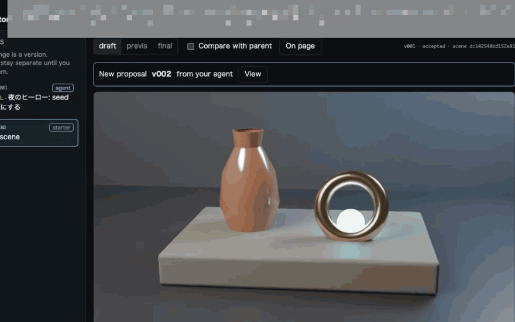
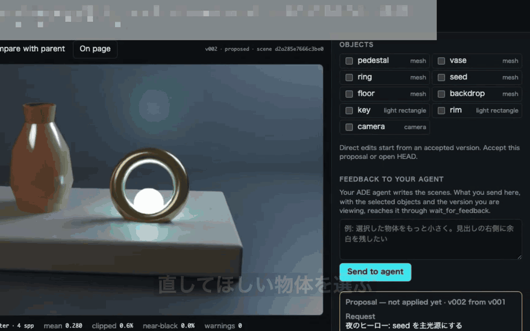
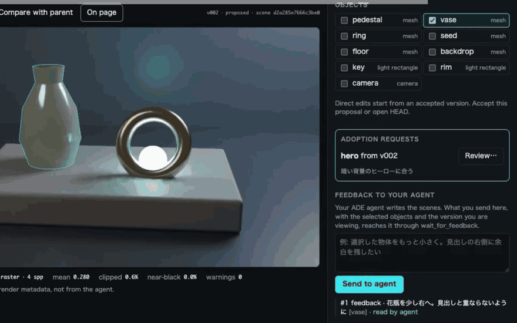

# クイックガイド: サンプルページで最初の画像を採用するまで

Claude Code に vork でヒーロー画像を作らせ、あなたが Director で確認して、プロジェクトに書き込むまでを通します。題材は同梱のサンプルページ [examples/landing](../examples/landing) です。

各項目の詳しい説明は [README](../README.md) にあります。ここでは一度動かすことだけを目指します。

## 準備

- vork 0.1.0 が入っていて、`vork --version` が通る
- Node.js 22.18 以降と Google Chrome
- Claude Code（ログイン済み）
- このリポジトリで `npm install` を済ませてある

## 1. サンプルを作業用に複製する

採用した画像はプロジェクトに書き込まれます。このリポジトリを汚さないよう、サンプルを別の場所に複製して使います。

```sh
cp -R /path/to/agent-render-review/examples/landing ~/vork-try
cd ~/vork-try
```

## 2. ページを配信し、設定を書く

別の端末でページを配信します。

```sh
npx serve ~/vork-try/public -l 5173
```

設定ファイルを作ります。これで、候補の画像を配信中のページに当てはめて見られます。

```sh
mkdir -p ~/vork-try/.vork
cat > ~/vork-try/.vork/config.json <<'EOF'
{
  "assetDir": "public/vork",
  "pageUrl": "http://127.0.0.1:5173/",
  "assetUrlPattern": "**/vork/hero.png"
}
EOF
```

## 3. MCP を登録して、エージェントに頼む

`~/vork-try` で登録し、Claude Code を起動します。

```sh
claude mcp add vork -- node /path/to/agent-render-review/mcp.mjs --project .
claude
```

頼む文の例:

> このページのヒーロー画像を vork で作って。Director で私に確認してから採用を依頼して

エージェントが最初に vork のツールを呼ぶと Director が起動し、ブラウザにレビュー用のタブが開きます。開かなかったら、エージェントに `open_review_tab` を呼ぶよう頼んでください。URL を直接開いたタブでは操作できません。

## 4. 提案を見比べる

提案が届くと、画面上部に通知が出ます。表示中の版は勝手に切り替わりません。「View」で開き、「Compare with parent」で元の版とワイプで比べます。



## 5. 直してほしい箇所を指して伝える

画像の物体をクリックするか、右の Objects で選び、直してほしい内容を書いて「Send to agent」を押します。エージェントが読むと「read by agent」に変わります。

「On page」を押すと、候補を配信中のページに当てはめた状態を確認できます。プロジェクトのファイルは変わりません。



## 6. 採用を承認する

納得したら、エージェントに採用を依頼させます。右に Adoption requests が出たら「Review…」を押し、書き込み先と上書きの有無を確かめて「Approve and write」を押します。final 品質で描き直してから書き込みます。



承認後、次の2つができます。

- `~/vork-try/public/vork/hero.png`: ページが参照するヒーロー画像
- `~/vork-try/.vork/adopted/hero.json`: シーン、vork の版、採用理由など。後で直すときに使う

`http://127.0.0.1:5173/` を開き直すと、ページに画像が入っています。

## 自分のプロジェクトで使うとき

手順2の `config.json` と手順3の登録を、自分のプロジェクトのルートで行います。CSS の背景画像や画像最適化を通す構成では、`assetUrlPattern` を実際に読み込まれる URL に合わせてください。合っていないと、On page で警告が出ます。

エージェントは採否や書き込みの承認をツールでは行えません。ただし、シェルを使えるエージェントはこの仕組みを回避できます。どこまで防げるかは README の「安全境界」を読んでください。
